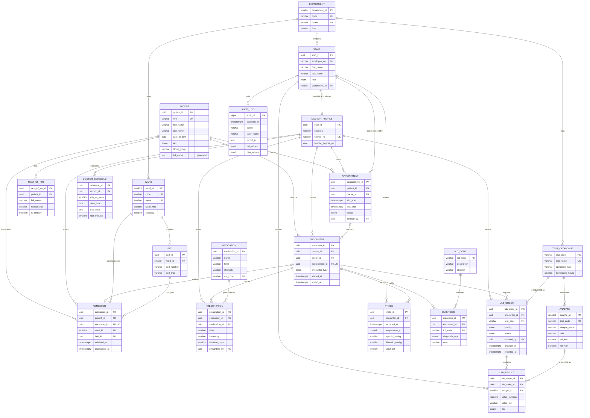

# ER Diagram

Source of truth for the entity-relationship model. Written in Mermaid so it renders
directly on GitHub and changes are reviewable as diffs. The model matches
[`schema.sql`](schema.sql) exactly — if they diverge, this file is wrong.

A rendered PNG is committed as [`er-diagram.png`](er-diagram.png) for the LMS document.

## Diagram



## Reading the Notation

Crow's foot notation, ISO cardinalities:

| Symbol | Meaning |
|---|---|
| `\|\|` | exactly one (mandatory) |
| `\|o` | zero or one (optional) |
| `}o` | zero or many |
| `}\|` | one or many |

So `PATIENT ||--o{ APPOINTMENT` reads: a patient has zero or many appointments, and
every appointment belongs to exactly one patient.

## Three Relationships Worth Pointing At

**`APPOINTMENT |o--o| ENCOUNTER`** — optional on both sides, because a cancelled or
no-show appointment produces no encounter, and a walk-in encounter has no appointment.
An inner join between these two tables silently loses rows; that is a deliberate
modelling choice, not an oversight.

**`DOCTOR_PROFILE` as a 1:1 extension of `STAFF`** — employment attributes and clinical
privileges have different lifetimes and different access rules. Splitting them means a
nurse cannot accidentally acquire a licence number, and clinical attributes can be
audited separately from HR records.

**`ANALYTE` between `TEST_CATALOGUE` and `LAB_RESULT`** — a test is a panel of analytes.
This is what allows one result table to serve a one-analyte test and a four-analyte
panel without a sparse wide table. It is also the structure Portfolio 4 replaces with
an embedded array, which is the comparison that portfolio is built on.

## Generating the PNG

The committed image is produced reproducibly by `scripts/export-diagram.ps1`. It extracts
the Mermaid block above and renders it with Mermaid CLI v12, using the Chrome already
installed on the machine so no Chromium download is required.

```powershell
powershell -NoProfile -ExecutionPolicy Bypass -File scripts/export-diagram.ps1
```

Equivalent once the block is saved as a `.mmd` file:

```bash
npx @mermaid-js/mermaid-cli@12 -i er-diagram.mmd -o er-diagram.png --size 2400 -b white
```

Note that Mermaid CLI v12 renamed the width flag: it is `--size`, not the `-w` used in most
tutorials.

## Tools Acknowledged

| Tool | Version | Used for |
|---|---|---|
| Mermaid CLI | 12.0.0 | Rendering the diagram source to PNG |
| Google Chrome | headless | Rendering engine used by Mermaid CLI |
| PostgreSQL | 16 | Verifying the schema the diagram describes |

The diagram is authored by hand from `schema.sql`. If the two diverge, `schema.sql` wins.
