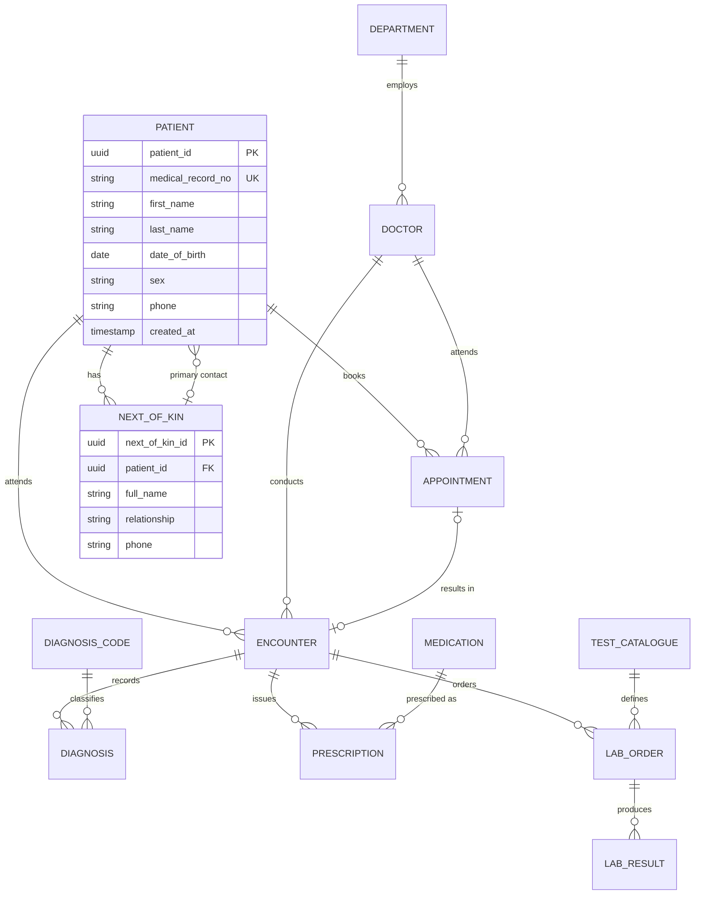

# ER Diagram

Source of truth for the entity-relationship model. Written in Mermaid so it renders
directly on GitHub and changes are reviewable as diffs.

Export to `er-diagram.png` for the LMS document.

## Diagram

> The block above is a **starting skeleton** — replace it as the model develops.
> Mermaid does not support composite attributes cleanly, so keep the diagram at entity
> and relationship level and put attribute detail in `schema.sql`.

## Rendering the PNG

Any of these work:

- **dbdiagram.io** — paste equivalent DBML, export PNG. Free tier prints a watermark.
- **Mermaid Live Editor** (mermaid.live) — paste the block, export PNG/SVG.
- **DBeaver / DataGrip** — reverse-engineer the live schema from the database and
  export. Best option, because the diagram is then guaranteed to match `schema.sql`.

Record which tool was used in `normalisation.md`, since the brief requires external
tools to be acknowledged.

## Notation

State the notation used (crow's foot / Chen) and what the cardinalities mean, e.g.
`||--o{` is one-to-many with mandatory-one on the left and zero-or-many on the right.
